<div align="center">

  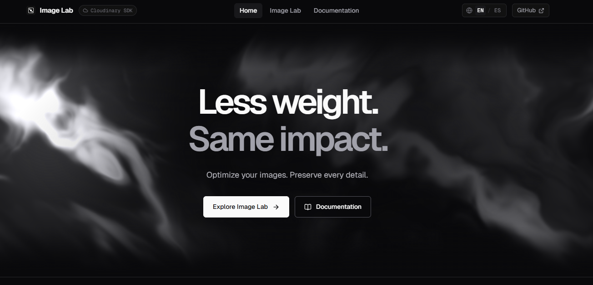

  <h1>Cloudinary Image Lab</h1>

  <p>
    <strong>Less weight. Same impact.</strong>
  </p>

  <p>
    An interactive playground for exploring modern image optimization,
    responsive media delivery, and Cloudinary transformations with Angular.
  </p>

  <p>
    
    
    
    
    
  </p>

  <p>
    <a href="#overview">Overview</a> ·
    <a href="#features">Features</a> ·
    <a href="#architecture">Architecture</a> ·
    <a href="#getting-started">Getting Started</a> ·
    <a href="#technical-article">Technical Article</a>
  </p>

</div>

---

## Overview

Images are an essential part of modern web experiences, but delivering them without proper optimization can significantly affect performance, bandwidth consumption, and user experience.

**Cloudinary Image Lab** is an open-source interactive playground designed to help developers understand how image optimization works in practice.

Rather than presenting image optimization as a collection of theoretical concepts, this project provides a visual environment where developers can explore transformations, compare images, inspect payload sizes, and experiment with different delivery configurations.

The application combines Angular's reactive architecture with Cloudinary's URL-based transformation capabilities to make image optimization accessible, measurable, and interactive.

### Project objectives

- Demonstrate practical image optimization techniques.
- Explore Cloudinary's dynamic transformation pipeline.
- Compare original and optimized image assets.
- Understand the relationship between image quality, format, dimensions, and file size.
- Provide reusable Angular integration examples.
- Promote performance-oriented frontend development.

---

## Features

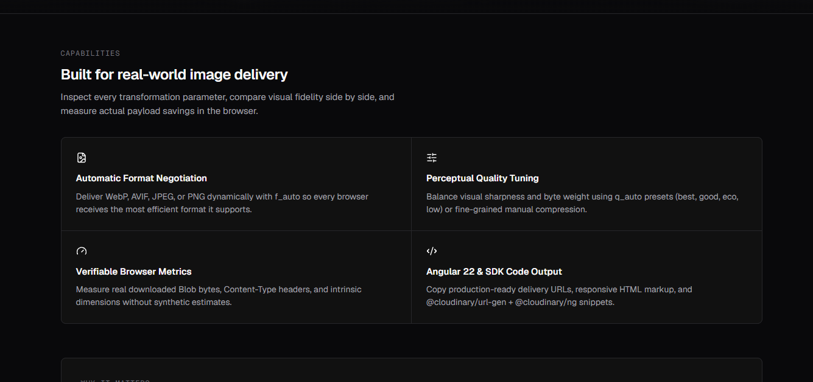

| Feature | Description |
| :--- | :--- |
| Image Optimization | Explore different image delivery configurations. |
| Visual Comparison | Compare original and transformed images side by side. |
| Performance Metrics | Inspect downloaded image sizes and optimization results. |
| Format Exploration | Understand modern formats such as WebP and AVIF. |
| Responsive Preview | Explore image delivery across different viewport sizes. |
| Code Playground | Inspect transformation URLs and Angular integration examples. |
| Demo Asset Gallery | Experiment with predefined image assets. |
| Internationalization | Explore the application in English and Spanish. |
| Technical Documentation | Learn the concepts behind modern media optimization. |

---

## Interactive Image Lab

The Image Lab is the core of the application.

It provides a dedicated workbench where developers can experiment with image transformations and understand how individual configuration decisions affect the resulting media asset.

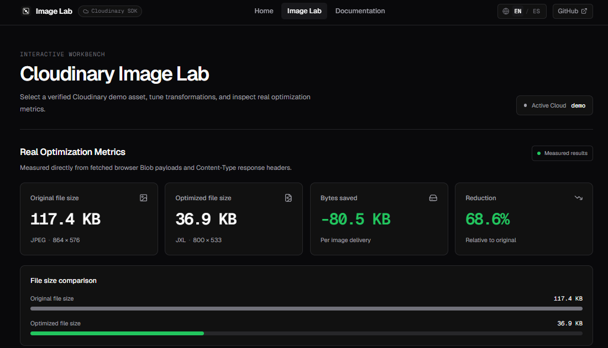

The experience focuses on connecting transformation parameters with observable visual and performance results.

---

## Image Comparison

Image optimization is not only about reducing file size. It is also about maintaining an appropriate level of visual quality.

The comparison interface helps developers evaluate the relationship between image appearance and delivery efficiency.

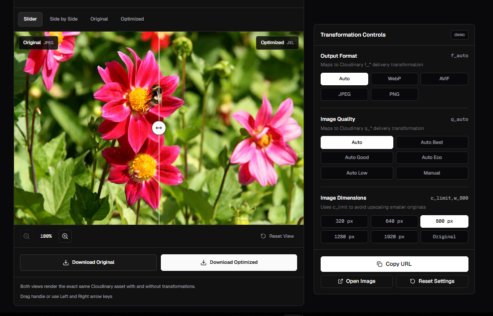

### Comparison workflow

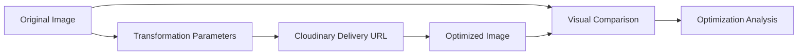

The comparison workflow makes it easier to understand the practical consequences of changing image delivery configurations.

---

## Demo Asset Gallery

The application includes a gallery of predefined assets for experimenting with image optimization.

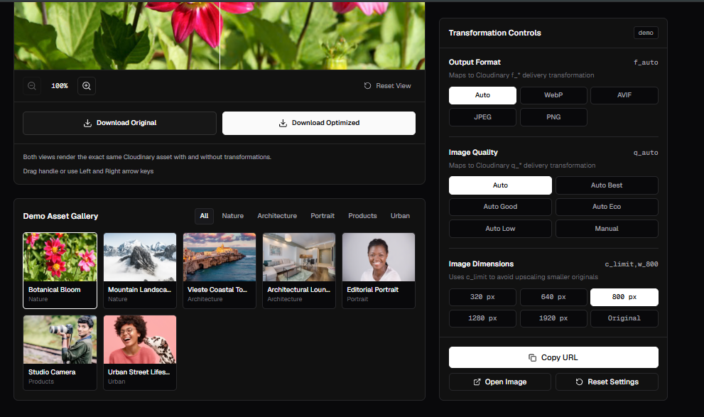

Using consistent source images makes it easier to explore how transformation parameters affect different types of visual content.

---

## Developer Tools

Cloudinary Image Lab is designed as both a visual playground and a developer learning resource.

Its developer-oriented tools help connect the application's interactive features with practical implementation concepts.

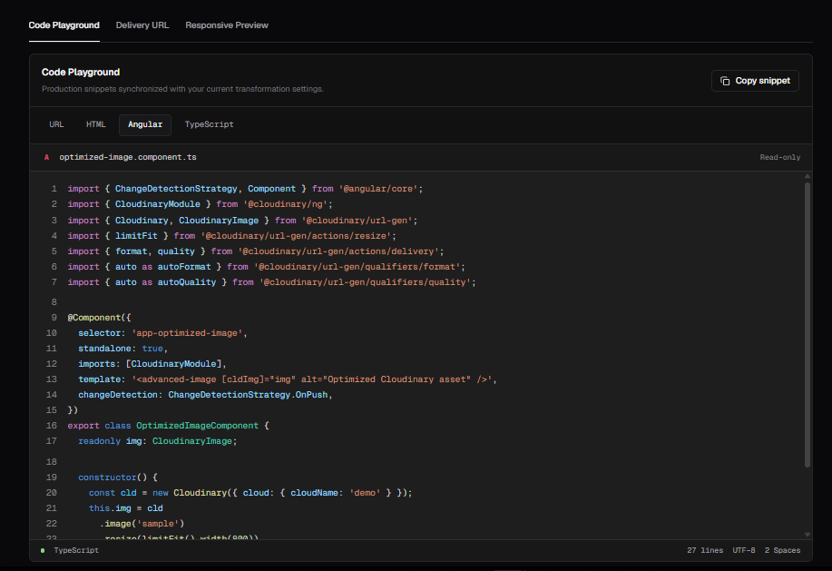

### Responsive preview

Responsive media delivery is an important part of building efficient web applications.

The responsive preview helps illustrate how different display sizes can influence image delivery requirements.

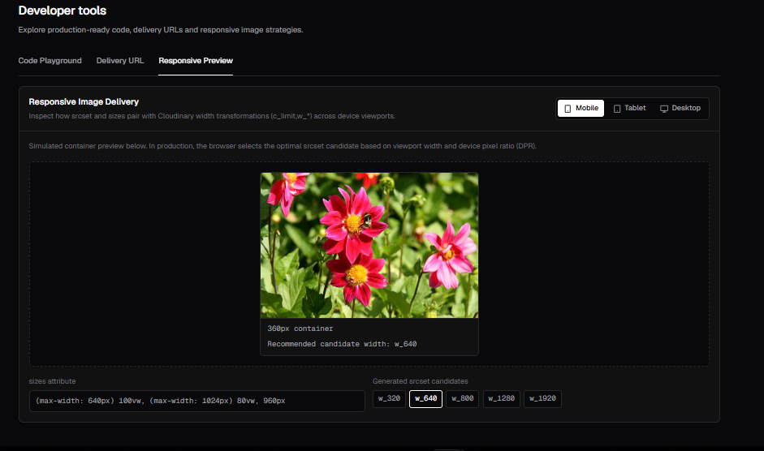

---

## Architecture

Cloudinary Image Lab follows a component-oriented frontend architecture.

The application separates user interface responsibilities, transformation configuration, image delivery, and optimization analysis into focused application concerns.

### High-level architecture

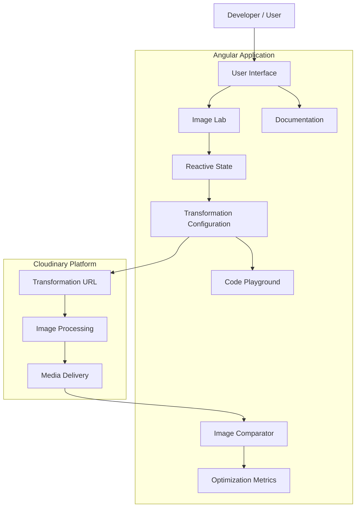

### Architecture principles

- Component-based development.
- Reactive state management with Angular Signals.
- Separation of concerns.
- Reusable interface components.
- Declarative image transformations.
- Performance-oriented media delivery.
- Maintainable TypeScript implementation.

---

## Image Delivery Pipeline

Cloudinary supports URL-based image transformations, allowing developers to request different versions of an image without manually creating separate optimized files.

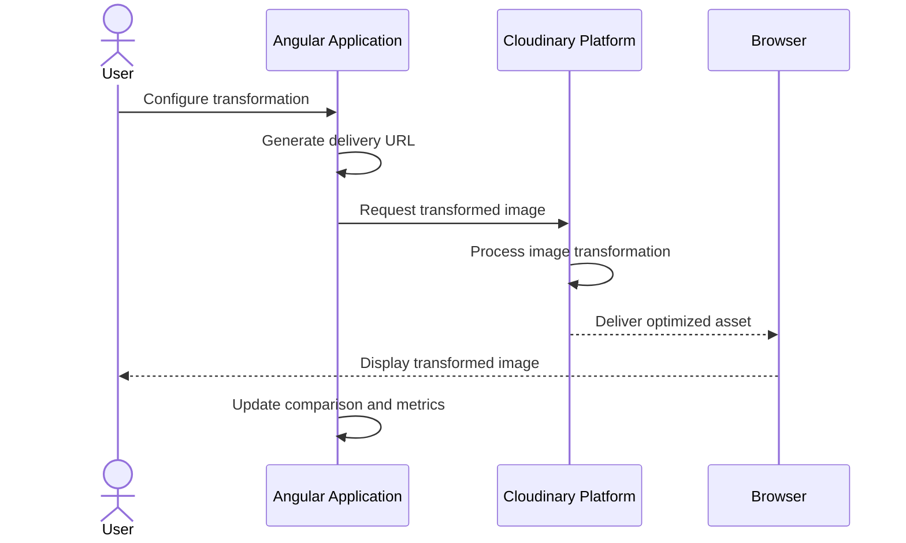

### Example transformation

```text
https://res.cloudinary.com/demo/image/upload/w_800,q_auto,f_auto/sample.jpg
```

| Parameter | Purpose |
| :--- | :--- |
| `w_800` | Requests an image width of 800 pixels. |
| `q_auto` | Automatically selects an appropriate quality configuration. |
| `f_auto` | Automatically selects a suitable delivery format. |

Combining these transformations can help reduce unnecessary image payloads while maintaining appropriate visual quality.

Actual optimization results depend on the source asset, transformation configuration, and delivery environment.

---

## Angular Integration

Angular provides the application structure, reactive state, and component-based interface used throughout Cloudinary Image Lab.

Cloudinary handles dynamic media transformations and image delivery.

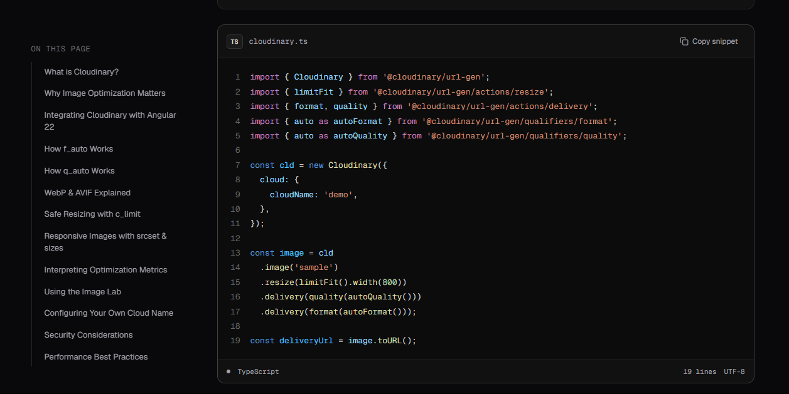

The following example illustrates the basic principle of generating a Cloudinary delivery URL in TypeScript:

```typescript
const cloudName = 'demo';
const publicId = 'sample';

const transformations = [
  'w_800',
  'q_auto',
  'f_auto'
].join(',');

const imageUrl =
  `https://res.cloudinary.com/${cloudName}` +
  `/image/upload/${transformations}/${publicId}.jpg`;
```

The generated URL can then be used as an image source within an Angular component.

```html

```

This example demonstrates the underlying delivery concept independently of the application's internal implementation.

---

## Technology Stack

| Technology | Responsibility |
| :--- | :--- |
| Angular | Frontend application framework |
| TypeScript | Application logic and type safety |
| Angular Signals | Reactive application state |
| Cloudinary | Image transformations and media delivery |
| Tailwind CSS | Interface styling |
| HTML and CSS | Semantic markup and visual presentation |
| Git | Version control |
| GitHub | Source code and project collaboration |

---

## Project Structure

The main application is organized around core functionality and feature-specific components.

```text
cloudinary-image-lab/
│
├── public/
│   ├── cloudinary-images/
│   │   └── webp/
│   └── i18n/
│       ├── en.json
│       └── es.json
│
├── src/
│   └── app/
│       ├── core/
│       │   └── constants/
│       │       └── demo-images.constant.ts
│       │
│       └── features/
│           └── image-lab/
│               ├── components/
│               │   ├── code-playground/
│               │   ├── image-comparator/
│               │   └── optimization-metrics/
│               │
│               └── pages/
│                   └── image-lab-page/
│
├── angular.json
├── package.json
├── tsconfig.json
└── README.md
```

This diagram highlights the main directories associated with the image optimization workbench.

---

## Getting Started

### Prerequisites

Before running the application locally, make sure you have:

- Node.js compatible with the project's Angular version.
- npm.
- Git.
- A modern web browser.
- A Cloudinary account if you intend to experiment with your own media assets.

### 1. Clone the repository

```bash
git clone https://github.com/Ezequie1Sc/cloudinary-image-lab.git
```

### 2. Navigate to the project

```bash
cd cloudinary-image-lab
```

### 3. Install dependencies

```bash
npm install
```

### 4. Start the development server

```bash
npm start
```

Open the application in your browser:

```text
http://localhost:4200
```

### 5. Create a production build

```bash
npm run build
```

---

## Testing

Automated testing is an important part of maintaining reliable application behavior.

The project includes component-level tests for parts of the image optimization workbench, including the image comparison and code playground interfaces.

Run the available test suite:

```bash
npm test
```

Run a production build to validate compilation:

```bash
npm run build
```

---

## Built-in Documentation

Cloudinary Image Lab includes educational content designed to explain the concepts behind image optimization and modern media delivery.

### What is Cloudinary?

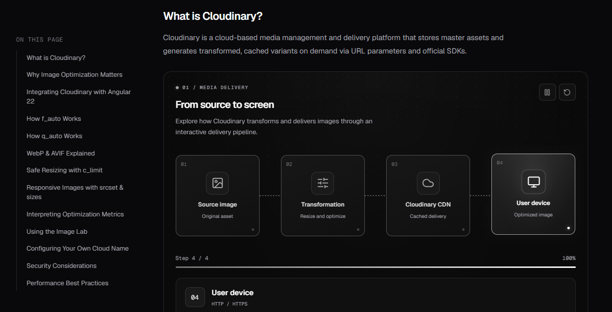

### Why image optimization?

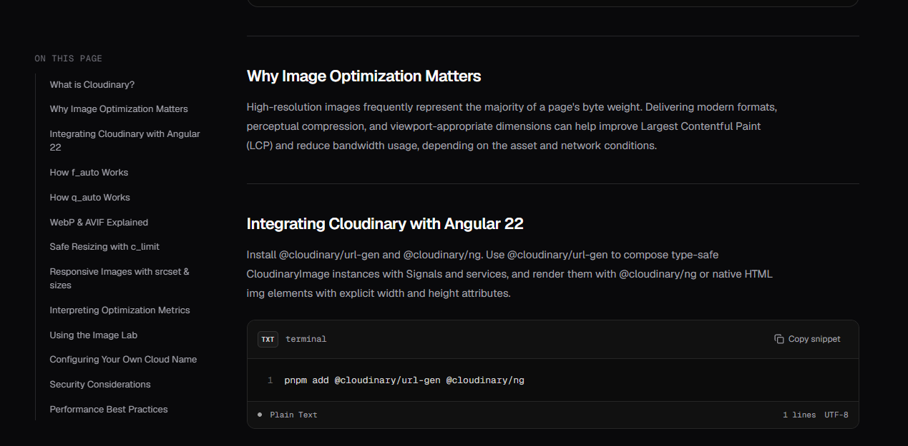

### Why it matters

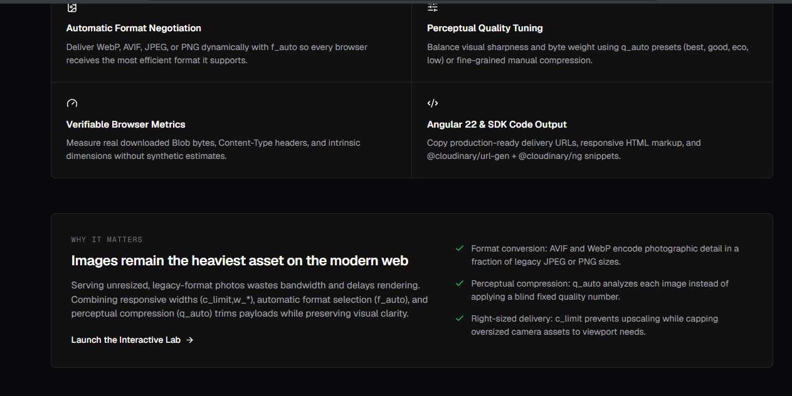

### Technical documentation

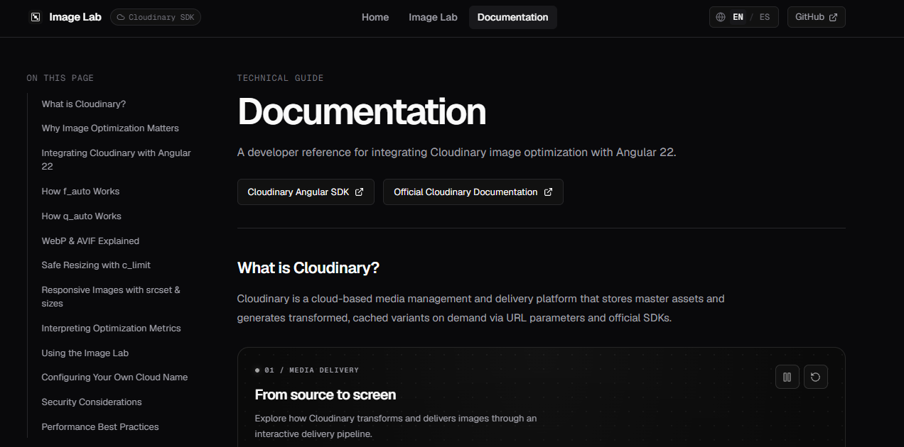

---

## Technical Article

This project is accompanied by a technical article published on DEV Community.

### Stop Serving Heavy Images: A Developer's Guide to Cloudinary and Angular

The article explores the fundamentals of image optimization, Cloudinary's URL-based transformation pipeline, Angular integration, and the architectural decisions behind Cloudinary Image Lab.

It is intended for developers interested in building faster, more efficient, and performance-oriented web applications.

<a href="https://dev.to/ezequie1sc/stop-serving-heavy-images-a-developers-guide-to-cloudinary-and-angular-4ho7">
  
</a>

**Read the full article:**

[Stop Serving Heavy Images: A Developer's Guide to Cloudinary and Angular](https://dev.to/ezequie1sc/stop-serving-heavy-images-a-developers-guide-to-cloudinary-and-angular-4ho7)

---

## Cloudinary Creators Community

Cloudinary Image Lab was developed as part of my journey within the **Cloudinary Creators Community**.

The project brings together two important aspects of developer growth:

- **Build & Share** — Developing a practical application that demonstrates Cloudinary's capabilities.
- **Write & Share** — Documenting technical concepts and sharing implementation knowledge with the developer community.

Through this project, I aim to contribute educational resources that help developers understand and adopt modern media optimization techniques.

Learn more about the program:

- [Cloudinary Creators Community](https://cloudinarycreators.com/)
- [Cloudinary Developer Documentation](https://cloudinary.com/documentation)
- [Cloudinary Academy](https://training.cloudinary.com/)

---

## Security

This project focuses on client-side media delivery and image transformation exploration.

When integrating Cloudinary into your own applications:

- Never expose your Cloudinary API Secret in frontend code.
- Keep sensitive credentials outside source control.
- Use server-side signing when authenticated operations require it.
- Review upload preset permissions before enabling public uploads.
- Validate user-provided transformation configurations where appropriate.

---

## Contributing

Contributions, suggestions, and feedback are welcome.

If you would like to contribute:

1. Fork this repository.
2. Create a feature branch.
3. Implement your changes.
4. Run the relevant tests.
5. Open a pull request with a clear description.

```bash
git checkout -b feat/your-feature
```

Please keep contributions focused, maintainable, and consistent with the project's architecture.

---

## License

This project is distributed under the MIT License.

See the [LICENSE](LICENSE) file for additional information.

---

## Author

**Orlando Ezequiel Salazar Cruz**

Computer Systems Engineering Student · Software Developer · Open Source Contributor

Passionate about software engineering, web technologies, developer communities, and building meaningful digital experiences.

<p>
  <a href="https://github.com/Ezequie1Sc">
    
  </a>
  <a href="https://dev.to/ezequie1sc">
    
  </a>
  <a href="https://ezequiel-dev-ia.vercel.app/">
    
  </a>
</p>

---

## Acknowledgments

Special thanks to:

- Cloudinary for its media transformation and delivery platform.
- The Cloudinary Creators Community for encouraging developers to build, learn, and share.
- The Angular team and open-source contributors.
- The developer community for continuously sharing knowledge and inspiration.

---

<div align="center">

  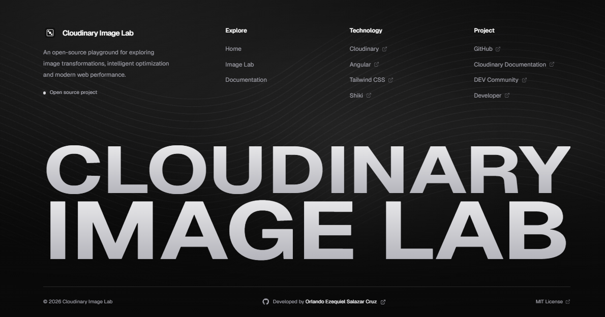

  <br />

  <strong>Less weight. Same impact.</strong>

  <p>Build better experiences. Deliver smarter images.</p>

  <sub>Built with curiosity, creativity, Angular, and Cloudinary.</sub>

</div>
